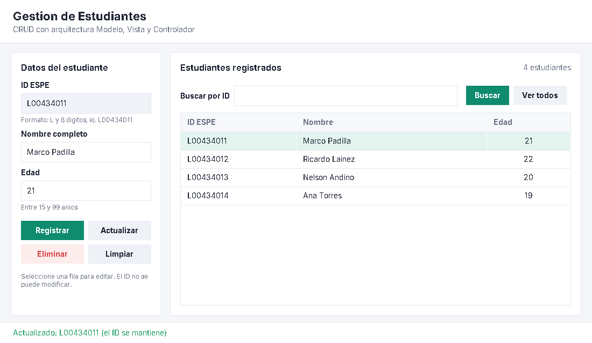
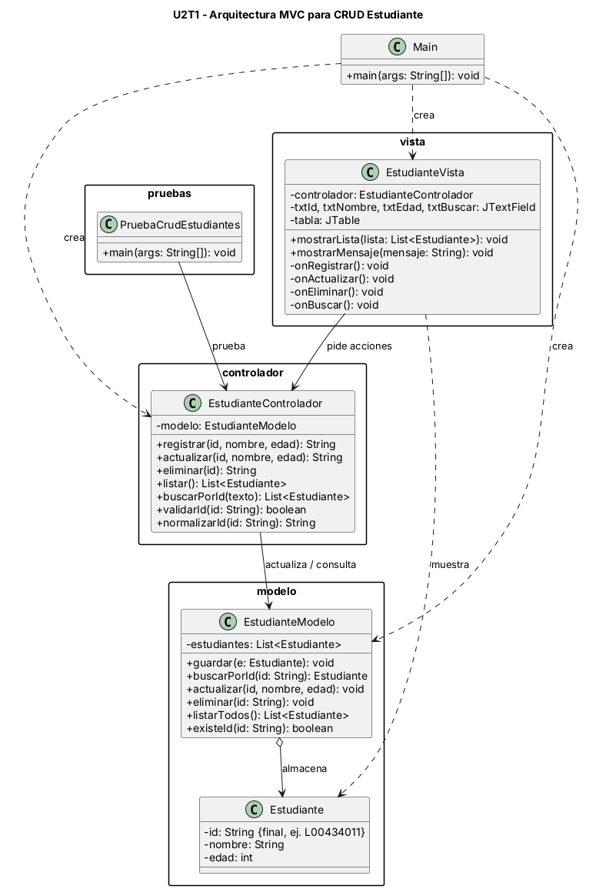

# U2T1 - CRUD Estudiante con arquitectura MVC

## Proposito

Disenar e implementar un CRUD base de estudiantes separando el sistema en Modelo,
Vista y Controlador (MVC). El CRUD permite registrar, consultar, buscar, actualizar
y eliminar estudiantes con los campos `ID`, `Nombre` y `Edad`. El ID sigue el formato
institucional de la ESPE (por ejemplo `L00434011`): lo ingresa el usuario, se valida
y no se puede modificar despues de registrar al estudiante.

## Productos verificables

| Producto | Estado | Evidencia |
| --- | --- | --- |
| Proyecto organizado en MVC | Cumplido | Carpetas `modelo`, `vista` y `controlador`. |
| Interfaz grafica minimalista | Cumplido | `vista/EstudianteVista.java` y `captura_gui.png`. |
| ID con formato ESPE no modificable | Cumplido | `Estudiante.id` es `final`; `EstudianteControlador.validarId` exige L y 8 digitos. |
| Diagrama de la arquitectura | Cumplido | `diagrama_mvc_crud_estudiante.puml` y `.png`. |
| Tabla de responsabilidades | Cumplido | Seccion "Responsabilidades MVC". |
| Matriz de trazabilidad | Cumplido | Seccion "Matriz de trazabilidad". |
| Pruebas de registro, consulta, actualizacion y eliminacion | Cumplido | `pruebas/PruebaCrudEstudiantes.java`. |

## Responsabilidades MVC

| Componente | Paquete | Responsabilidad | Clases |
| --- | --- | --- | --- |
| Modelo | `U2T1.modelo` | Representar al estudiante y guardar la coleccion en memoria. No conoce la vista. | `Estudiante`, `EstudianteModelo` |
| Vista | `U2T1.vista` | Mostrar el formulario, la tabla y los mensajes. Cada boton delega la accion en el controlador. No guarda datos ni valida reglas. | `EstudianteVista` |
| Controlador | `U2T1.controlador` | Recibir las acciones de la vista, validar el ID ESPE, el nombre y la edad, y llamar al modelo. | `EstudianteControlador` |
| Arranque | `U2T1` | Crear el modelo, el controlador y la vista y conectarlos. | `Main` |
| Pruebas | `U2T1.pruebas` | Probar el CRUD por consola sin la interfaz. | `PruebaCrudEstudiantes` |

## Regla del ID ESPE

| Regla | Implementacion |
| --- | --- |
| Formato: letra L y 8 digitos | `validarId` usa la expresion `L\d{8}`. |
| Mayusculas y espacios | `normalizarId` convierte `l00434011` en `L00434011`. |
| No se repite | `registrar` revisa `existeId` antes de guardar. |
| No se modifica | El atributo `id` es `final` y no tiene `setId`; en la vista el campo se bloquea al seleccionar una fila. |

## Matriz de trazabilidad

| Codigo | Requisito funcional | Operacion | Componentes implementados | Evidencia de prueba |
| --- | --- | --- | --- | --- |
| RF-01 | El sistema debe permitir registrar un estudiante con ID ESPE, Nombre y Edad. | Create | `EstudianteVista.onRegistrar`, `EstudianteControlador.registrar`, `EstudianteModelo.guardar`, `Estudiante` | `PruebaCrudEstudiantes`: bloque "RF-01 Registrar" |
| RF-02 | El sistema debe permitir actualizar el nombre y la edad sin modificar el ID. | Update | `EstudianteVista.onActualizar`, `EstudianteControlador.actualizar`, `EstudianteModelo.actualizar` | Bloque "RF-02 Actualizar" |
| RF-03 | El sistema debe permitir eliminar un estudiante. | Delete | `EstudianteVista.onEliminar`, `EstudianteControlador.eliminar`, `EstudianteModelo.eliminar` | Bloque "RF-03 Eliminar" |
| RF-04 | El sistema debe mostrar los estudiantes y buscarlos por ID. | Read | `EstudianteVista.mostrarLista`, `EstudianteVista.onBuscar`, `EstudianteControlador.listar`, `EstudianteControlador.buscarPorId` | Bloques "RF-04 Consultar" y "RF-04 Buscar por ID" |
| RF-05 | El sistema debe validar el ID ESPE, el nombre y la edad (15 a 99) antes de guardar. | Validacion | `EstudianteControlador.validarId`, `normalizarId`, `validarDatos` | Bloque "RF-05 Validar" |

## Interfaz grafica

| Panel | Uso |
| --- | --- |
| Datos del estudiante | Formulario con ID ESPE, Nombre y Edad, y botones Registrar, Actualizar, Eliminar y Limpiar. Al seleccionar una fila el ID se bloquea. |
| Estudiantes registrados | Tabla con los estudiantes y buscador por ID completo o parcial. |
| Barra inferior | Resultado de cada accion en verde (exito) o rojo (error). |



## Diagrama PlantUML

El diagrama esta en `diagrama_mvc_crud_estudiante.puml` y su imagen en `diagrama_mvc_crud_estudiante.png`.



Resumen del flujo:

```text
Usuario -> EstudianteVista -> EstudianteControlador -> EstudianteModelo -> Estudiante
                 ^                     |
                 +---- mensaje y lista-+
```

## Criterios de aceptacion

| Criterio | Cumplimiento |
| --- | --- |
| La vista no accede directamente a los datos. | Cumplido: `EstudianteVista` solo llama a `EstudianteControlador`. |
| Las validaciones estan en el controlador. | Cumplido: `validarId` y `validarDatos` estan en `EstudianteControlador`. |
| El ID es el de la ESPE y no se modifica. | Cumplido: ver seccion "Regla del ID ESPE". |
| Las operaciones CRUD estan vinculadas a requisitos. | Cumplido: ver matriz RF-01 a RF-05. |
| El proyecto es comprensible, ejecutable y documentado. | Cumplido: README, PlantUML, interfaz y prueba de consola. |

## Como ejecutar

Desde PowerShell, ubicarse en la carpeta padre de `U2T1`:

```powershell
cd "C:\Users\adria\Documents\GitHub\RicardoLainez36838_G5_ADSW\PROYECTO\2. DISEÑOS"
```

Compilar:

```powershell
javac (Get-ChildItem "U2T1" -Recurse -Filter *.java | Select-Object -ExpandProperty FullName)
```

Ejecutar la interfaz grafica:

```powershell
java U2T1.Main
```

Ejecutar la prueba de consola:

```powershell
java U2T1.pruebas.PruebaCrudEstudiantes
```

## Evidencia esperada de consola

```text
=== RF-01 Registrar ===
Registrado: Marco Padilla (L00434011)
Registrado: Ricardo Lainez (L00434012)

=== RF-05 Validar ===
Error: ID invalido. Use el formato ESPE: L seguido de 8 digitos (ej. L00434011).
Error: Ya existe un estudiante con el ID L00434011.
Error: Nombre obligatorio y Edad entre 15 y 99.

=== RF-04 Consultar ===
Estudiante [ID=L00434011, Nombre=Marco Padilla, Edad=21]
Estudiante [ID=L00434012, Nombre=Ricardo Lainez, Edad=22]

=== RF-02 Actualizar ===
Actualizado: L00434011 (el ID se mantiene)

=== RF-04 Buscar por ID ===
Estudiante [ID=L00434012, Nombre=Ricardo Lainez, Edad=22]

=== RF-03 Eliminar ===
Eliminado: Ricardo Lainez (L00434012)

=== Lista final ===
Estudiante [ID=L00434011, Nombre=Marco Adrian Padilla, Edad=22]
```

## Informe

- [Informe_U2T1_CRUD_MVC_G5.pdf](Informe_U2T1_CRUD_MVC_G5.pdf)
- [Informe_U2T1_CRUD_MVC_G5.docx](Informe_U2T1_CRUD_MVC_G5.docx)
