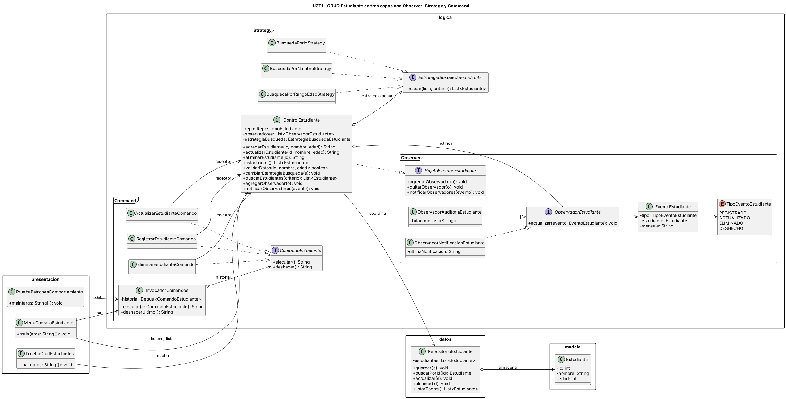

# U2T1 - CRUD Estudiante con patrones de comportamiento (Observer, Strategy y Command)

## Proposito

Disenar e implementar un CRUD de estudiantes en arquitectura de tres capas
(Presentacion, Logica de negocio, Datos y Modelo) y aplicar sobre el tres patrones
de diseno de comportamiento: Observer, Strategy y Command. El CRUD permite
registrar, consultar, actualizar, eliminar y buscar estudiantes con los campos
`ID`, `Nombre` y `Edad`. La version actual funciona por consola.

## Productos verificables

| Producto | Estado | Evidencia |
| --- | --- | --- |
| Proyecto base organizado en tres capas | Cumplido | Carpetas `presentacion`, `logica`, `datos` y `modelo`. |
| Patron Observer aplicado | Cumplido | `SujetoEventosEstudiante`, `ObservadorEstudiante`, `ObservadorAuditoriaEstudiante`, `ObservadorNotificacionEstudiante`. |
| Patron Strategy aplicado | Cumplido | `EstrategiaBusquedaEstudiante` y sus tres estrategias de busqueda. |
| Patron Command aplicado | Cumplido | `ComandoEstudiante`, tres comandos concretos e `InvocadorComandos`. |
| Diagrama de clases con los patrones | Cumplido | `diagrama_patrones_comportamiento.puml` y `.png`. |
| Tabla de responsabilidades por capa | Cumplido | Seccion "Responsabilidades por capa". |
| Matriz de trazabilidad | Cumplido | Seccion "Matriz de trazabilidad". |
| Pruebas por consola | Cumplido | `PruebaCrudEstudiantes`, `PruebaPatronesComportamiento` y `MenuConsolaEstudiantes`. |

## Responsabilidades por capa

| Capa | Paquete | Responsabilidad | Clases |
| --- | --- | --- | --- |
| Presentacion | `U2T1.presentacion` | Capturar datos por consola, invocar la logica y mostrar resultados. No accede a persistencia. | `PruebaCrudEstudiantes`, `PruebaPatronesComportamiento`, `MenuConsolaEstudiantes` |
| Logica de negocio | `U2T1.logica` | Validar datos, aplicar reglas academicas, coordinar el CRUD y alojar los patrones de comportamiento. | `ControlEstudiante` y las clases de Observer, Strategy y Command |
| Datos | `U2T1.datos` | Gestionar la coleccion de estudiantes en memoria sin reglas de negocio. | `RepositorioEstudiante` |
| Modelo | `U2T1.modelo` | Representar la entidad del dominio con ID, Nombre y Edad. | `Estudiante` |

## Patrones de comportamiento aplicados

### Observer

Problema que resuelve: cuando cambia un estudiante, otras partes del sistema deben
enterarse (auditoria y avisos) sin que el CRUD dependa de ellas.

| Rol del patron | Clase |
| --- | --- |
| Sujeto (contrato) | `SujetoEventosEstudiante` |
| Sujeto concreto | `ControlEstudiante` |
| Observador (contrato) | `ObservadorEstudiante` |
| Observadores concretos | `ObservadorAuditoriaEstudiante` (bitacora), `ObservadorNotificacionEstudiante` (aviso en consola) |
| Datos del evento | `EventoEstudiante`, `TipoEventoEstudiante` (`REGISTRADO`, `ACTUALIZADO`, `ELIMINADO`, `DESHECHO`) |

Justificacion: agregar un nuevo observador (por ejemplo, enviar un correo) no
obliga a modificar `ControlEstudiante`, solo se registra con `agregarObservador`.

### Strategy

Problema que resuelve: la forma de buscar estudiantes cambia segun lo que necesite
el usuario.

| Rol del patron | Clase |
| --- | --- |
| Estrategia (contrato) | `EstrategiaBusquedaEstudiante` |
| Estrategias concretas | `BusquedaPorIdStrategy`, `BusquedaPorNombreStrategy`, `BusquedaPorRangoEdadStrategy` |
| Contexto | `ControlEstudiante` (`cambiarEstrategiaBusqueda`, `buscarEstudiantes`) |

Justificacion: el algoritmo de busqueda se cambia en tiempo de ejecucion y una
nueva busqueda se agrega con una clase nueva, sin tocar el codigo que la usa.

### Command

Problema que resuelve: guardar las operaciones del CRUD como objetos para poder
llevar un historial y deshacer la ultima accion.

| Rol del patron | Clase |
| --- | --- |
| Comando (contrato) | `ComandoEstudiante` (`ejecutar`, `deshacer`) |
| Comandos concretos | `RegistrarEstudianteComando`, `ActualizarEstudianteComando`, `EliminarEstudianteComando` |
| Invocador | `InvocadorComandos` (historial y `deshacerUltimo`) |
| Receptor | `ControlEstudiante` |
| Cliente | `PruebaPatronesComportamiento`, `MenuConsolaEstudiantes` |

Justificacion: la presentacion no llama directamente a cada metodo del CRUD, pide
la operacion al invocador. Cada comando guarda el estado anterior que necesita
para deshacerse y solo los comandos exitosos entran al historial.

## Matriz de trazabilidad

| Codigo | Requisito funcional | Operacion | Patron | Componentes implementados | Evidencia de prueba |
| --- | --- | --- | --- | --- | --- |
| RF-01 | El sistema debe permitir registrar un estudiante con ID, Nombre y Edad. | Create | Command + Observer | `RegistrarEstudianteComando`, `ControlEstudiante.agregarEstudiante`, `RepositorioEstudiante.guardar`, evento `REGISTRADO` | `PruebaPatronesComportamiento`: bloque "Registrar (RF-01)" |
| RF-02 | El sistema debe permitir actualizar los datos de un estudiante existente. | Update | Command + Observer | `ActualizarEstudianteComando`, `ControlEstudiante.actualizarEstudiante`, `RepositorioEstudiante.actualizar`, evento `ACTUALIZADO` | Bloque "Actualizar (RF-02)" |
| RF-03 | El sistema debe permitir eliminar un estudiante segun la regla academica (mayor de 18 anios). | Delete | Command + Observer | `EliminarEstudianteComando`, `ControlEstudiante.eliminarEstudiante`, `RepositorioEstudiante.eliminar`, evento `ELIMINADO` | Bloque "Eliminar (RF-03)": el menor de edad no se elimina ni notifica |
| RF-04 | El sistema debe mostrar todos los estudiantes registrados. | Read/List | Ninguno (CRUD base) | `ControlEstudiante.listarTodos`, `RepositorioEstudiante.listarTodos` | Bloque "Lista final" |
| RF-05 | El sistema debe validar datos obligatorios antes de guardar o actualizar. | Validacion | Ninguno (CRUD base) | `ControlEstudiante.validarDatos` | `PruebaCrudEstudiantes`: bloque "RF-05 Validar" |
| RF-06 | El sistema debe permitir buscar estudiantes por ID, Nombre o Rango de edad. | Read/Buscar | Strategy | `EstrategiaBusquedaEstudiante`, estrategias concretas, `ControlEstudiante.buscarEstudiantes` | Bloque "Buscar (RF-06)" |
| RF-07 | El sistema debe permitir deshacer la ultima operacion del CRUD. | Deshacer | Command + Observer | `InvocadorComandos.deshacerUltimo`, metodo `deshacer` de cada comando, evento `DESHECHO` | Bloque "Historial y deshacer (RF-07)" |
| RNF-01 | El sistema debe registrar en una bitacora los cambios del CRUD (mantenibilidad y auditoria). | Auditoria | Observer | `ObservadorAuditoriaEstudiante` | Bloque "Bitacora de auditoria" |

## Diagrama PlantUML

El diagrama de clases esta en `diagrama_patrones_comportamiento.puml` y su imagen
en `diagrama_patrones_comportamiento.png`.



Resumen del flujo:

```text
Presentacion -> InvocadorComandos -> Comando -> ControlEstudiante -> RepositorioEstudiante -> Estudiante
                                                ControlEstudiante -> Observadores (auditoria, notificacion)
                                                ControlEstudiante -> EstrategiaBusqueda (ID, Nombre, Rango de edad)
```

## Criterios de aceptacion

| Criterio | Cumplimiento |
| --- | --- |
| La capa de presentacion no accede directamente a la persistencia. | Cumplido: solo usa `InvocadorComandos` y `ControlEstudiante`. |
| Las validaciones y reglas estan en la logica de negocio. | Cumplido: `validarDatos` y la regla de eliminacion estan en `ControlEstudiante`. |
| Los patrones se ubican en la logica de negocio. | Cumplido: todas las clases de Observer, Strategy y Command estan en `U2T1.logica`. |
| Cada patron esta vinculado a un requisito. | Cumplido: ver matriz RF-01 a RF-07 y RNF-01. |
| El proyecto es comprensible, ejecutable y documentado. | Cumplido: README, PlantUML y pruebas de consola. |

## Como ejecutar

Desde PowerShell, ubicarse en la carpeta padre de `U2T1`:

```powershell
cd "C:\Users\adria\Documents\GitHub\RicardoLainez36838_G5_ADSW\PROYECTO\2. DISEÑOS"
```

Compilar:

```powershell
javac (Get-ChildItem "U2T1" -Recurse -Filter *.java | Select-Object -ExpandProperty FullName)
```

Ejecutar la prueba del CRUD base:

```powershell
java U2T1.presentacion.PruebaCrudEstudiantes
```

Ejecutar la prueba de los tres patrones:

```powershell
java U2T1.presentacion.PruebaPatronesComportamiento
```

Ejecutar el menu interactivo por consola:

```powershell
java U2T1.presentacion.MenuConsolaEstudiantes
```

## Evidencia esperada de consola (PruebaPatronesComportamiento)

```text
=== COMMAND + OBSERVER: Registrar (RF-01) ===
   Notificacion: estudiante registrado -> Estudiante [ID=1, Nombre=Ana Torres, Edad=20]
Agregado exitosamente: Ana Torres
   Notificacion: estudiante registrado -> Estudiante [ID=2, Nombre=Luis Perez, Edad=17]
Agregado exitosamente: Luis Perez
   Notificacion: estudiante registrado -> Estudiante [ID=3, Nombre=Maria Andrade, Edad=23]
Agregado exitosamente: Maria Andrade
Error: Datos invalidos. ID y Edad deben ser mayores a 0, Nombre no puede estar vacio.

=== COMMAND + OBSERVER: Actualizar (RF-02) ===
   Notificacion: estudiante actualizado -> Estudiante [ID=1, Nombre=Ana Torres Vega, Edad=21]
Actualizado exitosamente: ID 1

=== COMMAND + OBSERVER: Eliminar (RF-03) ===
Error: Regla academica - no se puede eliminar a 'Luis Perez' porque es menor de 18 anios (Edad: 17).
   Notificacion: estudiante eliminado -> Estudiante [ID=3, Nombre=Maria Andrade, Edad=23]
Eliminado exitosamente: Maria Andrade (ID 3)

=== STRATEGY: Buscar (RF-06) ===
Estrategia por ID, criterio '1':
   Estudiante [ID=1, Nombre=Ana Torres Vega, Edad=21]
Estrategia por Nombre, criterio 'perez':
   Estudiante [ID=2, Nombre=Luis Perez, Edad=17]
Estrategia por Rango de edad, criterio '18-30':
   Estudiante [ID=1, Nombre=Ana Torres Vega, Edad=21]

=== COMMAND: Historial y deshacer (RF-07) ===
Historial: [Registrar ID 1 (Ana Torres), Registrar ID 2 (Luis Perez), Registrar ID 3 (Maria Andrade), Actualizar ID 1, Eliminar ID 3]
   Notificacion: operacion deshecha -> Estudiante [ID=3, Nombre=Maria Andrade, Edad=23]
Deshacer [Eliminar ID 3]: Eliminacion deshecha: Maria Andrade vuelve al registro
   Notificacion: operacion deshecha -> Estudiante [ID=1, Nombre=Ana Torres, Edad=20]
Deshacer [Actualizar ID 1]: Actualizacion deshecha: Estudiante [ID=1, Nombre=Ana Torres, Edad=20]
Historial: [Registrar ID 1 (Ana Torres), Registrar ID 2 (Luis Perez), Registrar ID 3 (Maria Andrade)]

=== RF-04 Lista final ===
Estudiante [ID=1, Nombre=Ana Torres, Edad=20]
Estudiante [ID=2, Nombre=Luis Perez, Edad=17]
Estudiante [ID=3, Nombre=Maria Andrade, Edad=23]

=== OBSERVER: Bitacora de auditoria ===
   [REGISTRADO] Se registro Ana Torres (ID 1)
   [REGISTRADO] Se registro Luis Perez (ID 2)
   [REGISTRADO] Se registro Maria Andrade (ID 3)
   [ACTUALIZADO] Se actualizo el ID 1 a Ana Torres Vega, 21 anios
   [ELIMINADO] Se elimino Maria Andrade (ID 3)
   [DESHECHO] Se restauro a Maria Andrade (ID 3)
   [DESHECHO] Se restauraron los datos del ID 1
```
