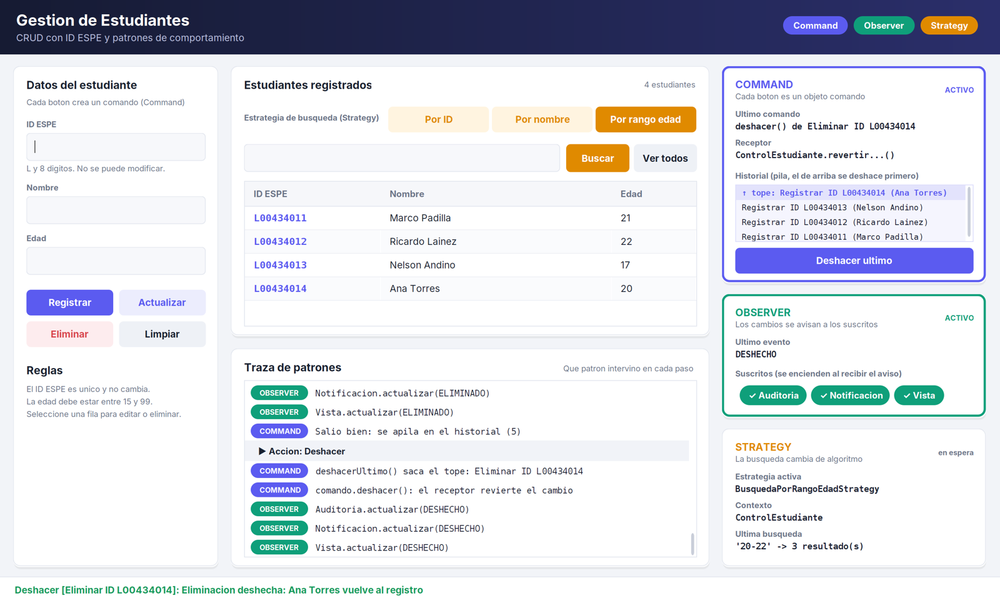
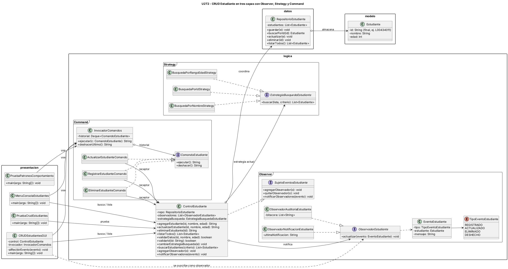

# U2T2 - CRUD Estudiante con patrones de comportamiento (Observer, Strategy y Command)

## Proposito

Esta tarea parte del CRUD de estudiantes de U2T1 (MVC con ID ESPE) y lo reorganiza
en capas para aplicar los patrones de comportamiento.

Disenar e implementar un CRUD de estudiantes en arquitectura de tres capas
(Presentacion, Logica de negocio, Datos y Modelo) y aplicar sobre el tres patrones
de diseno de comportamiento: Observer, Strategy y Command. El CRUD permite
registrar, consultar, actualizar, eliminar y buscar estudiantes con los campos
`ID`, `Nombre` y `Edad`. El ID sigue el formato institucional de la ESPE (por
ejemplo `L00434011`), lo ingresa el usuario y no se puede modificar. El proyecto
tiene una interfaz grafica (`CRUDEstudiantesGUI`) y pruebas por consola.

## Productos verificables

| Producto | Estado | Evidencia |
| --- | --- | --- |
| Proyecto base organizado en tres capas | Cumplido | Carpetas `presentacion`, `logica`, `datos` y `modelo`. |
| Una carpeta por patron | Cumplido | `logica/observer`, `logica/strategy` y `logica/command`. |
| Patron Observer aplicado | Cumplido | `SujetoEventosEstudiante`, `ObservadorEstudiante`, `ObservadorAuditoriaEstudiante`, `ObservadorNotificacionEstudiante`. |
| Patron Strategy aplicado | Cumplido | `EstrategiaBusquedaEstudiante` y sus tres estrategias de busqueda. |
| Patron Command aplicado | Cumplido | `ComandoEstudiante`, tres comandos concretos e `InvocadorComandos`. |
| Diagrama de clases con los patrones | Cumplido | `diagrama_patrones_comportamiento.puml` y `.png`. |
| Tabla de responsabilidades por capa | Cumplido | Seccion "Responsabilidades por capa". |
| Matriz de trazabilidad | Cumplido | Seccion "Matriz de trazabilidad". |
| Interfaz que evidencia los patrones | Cumplido | `CRUDEstudiantesGUI` (tarjetas por patron y traza de patrones) y `captura_gui.png`. |
| ID con formato ESPE no modificable | Cumplido | `Estudiante.id` es `final`; `ControlEstudiante.validarId` exige L y 8 digitos. |
| Pruebas por consola | Cumplido | `PruebaCrudEstudiantes`, `PruebaPatronesComportamiento` y `MenuConsolaEstudiantes`. |

## Estructura de carpetas

```text
U2T2/
├── modelo/                 Estudiante
├── datos/                  RepositorioEstudiante
├── logica/
│   ├── ControlEstudiante.java
│   ├── observer/           SujetoEventosEstudiante, ObservadorEstudiante,
│   │                       ObservadorAuditoriaEstudiante, ObservadorNotificacionEstudiante,
│   │                       EventoEstudiante, TipoEventoEstudiante
│   ├── strategy/           EstrategiaBusquedaEstudiante, BusquedaPorIdStrategy,
│   │                       BusquedaPorNombreStrategy, BusquedaPorRangoEdadStrategy
│   └── command/            ComandoEstudiante, InvocadorComandos,
│                           RegistrarEstudianteComando, ActualizarEstudianteComando,
│                           EliminarEstudianteComando
└── presentacion/           CRUDEstudiantesGUI, MenuConsolaEstudiantes,
                            PruebaCrudEstudiantes, PruebaPatronesComportamiento
```

`ControlEstudiante` queda en `logica` porque participa en los tres patrones: es el
sujeto de Observer, el contexto de Strategy y el receptor de Command.

## Responsabilidades por capa

| Capa | Paquete | Responsabilidad | Clases |
| --- | --- | --- | --- |
| Presentacion | `U2T2.presentacion` | Capturar datos (interfaz grafica o consola), invocar la logica y mostrar resultados. No accede a persistencia. | `CRUDEstudiantesGUI`, `PruebaCrudEstudiantes`, `PruebaPatronesComportamiento`, `MenuConsolaEstudiantes` |
| Logica de negocio | `U2T2.logica` | Validar datos, aplicar las validaciones y coordinar el CRUD. | `ControlEstudiante` |
| Patron Observer | `U2T2.logica.observer` | Avisar los cambios del CRUD a los suscritos. | `SujetoEventosEstudiante`, `ObservadorEstudiante`, `ObservadorAuditoriaEstudiante`, `ObservadorNotificacionEstudiante`, `EventoEstudiante`, `TipoEventoEstudiante` |
| Patron Strategy | `U2T2.logica.strategy` | Intercambiar el criterio de busqueda. | `EstrategiaBusquedaEstudiante`, `BusquedaPorIdStrategy`, `BusquedaPorNombreStrategy`, `BusquedaPorRangoEdadStrategy` |
| Patron Command | `U2T2.logica.command` | Encapsular cada operacion con historial y deshacer. | `ComandoEstudiante`, `InvocadorComandos`, `RegistrarEstudianteComando`, `ActualizarEstudianteComando`, `EliminarEstudianteComando` |
| Datos | `U2T2.datos` | Gestionar la coleccion de estudiantes en memoria sin reglas de negocio. | `RepositorioEstudiante` |
| Modelo | `U2T2.modelo` | Representar la entidad del dominio con ID ESPE (final), Nombre y Edad. | `Estudiante` |

## Patrones de comportamiento aplicados

### Observer

Problema que resuelve: cuando cambia un estudiante, otras partes del sistema deben
enterarse (auditoria y avisos) sin que el CRUD dependa de ellas.

| Rol del patron | Clase |
| --- | --- |
| Sujeto (contrato) | `SujetoEventosEstudiante` |
| Sujeto concreto | `ControlEstudiante` |
| Observador (contrato) | `ObservadorEstudiante` |
| Observadores concretos | `ObservadorAuditoriaEstudiante` (bitacora), `ObservadorNotificacionEstudiante` (aviso en consola) y la propia `CRUDEstudiantesGUI`, que se suscribe para refrescar la tabla |
| Datos del evento | `EventoEstudiante`, `TipoEventoEstudiante` (`REGISTRADO`, `ACTUALIZADO`, `ELIMINADO`, `DESHECHO`) |

Justificacion: agregar un nuevo observador (por ejemplo, enviar un correo) no
obliga a modificar `ControlEstudiante`, solo se registra con `agregarObservador`.

### Strategy

Problema que resuelve: la forma de buscar estudiantes cambia segun lo que necesite
el usuario.

| Rol del patron | Clase |
| --- | --- |
| Estrategia (contrato) | `EstrategiaBusquedaEstudiante` |
| Estrategias concretas | `BusquedaPorIdStrategy` (ID ESPE completo o parcial), `BusquedaPorNombreStrategy`, `BusquedaPorRangoEdadStrategy` |
| Contexto | `ControlEstudiante` (`cambiarEstrategiaBusqueda`, `buscarEstudiantes`) |

Justificacion: el algoritmo de busqueda se cambia en tiempo de ejecucion y una
nueva busqueda se agrega con una clase nueva, sin tocar el codigo que la usa.

### Command

Problema que resuelve: guardar las operaciones del CRUD como objetos para poder
llevar un historial y deshacer la ultima accion.

| Rol del patron | Clase |
| --- | --- |
| Comando (contrato) | `ComandoEstudiante` (`ejecutar`, `deshacer`) |
| Comandos concretos | `RegistrarEstudianteComando`, `ActualizarEstudianteComando`, `EliminarEstudianteComando` |
| Invocador | `InvocadorComandos` (historial y `deshacerUltimo`) |
| Receptor | `ControlEstudiante` |
| Cliente | `CRUDEstudiantesGUI`, `PruebaPatronesComportamiento`, `MenuConsolaEstudiantes` |

Justificacion: la presentacion no llama directamente a cada metodo del CRUD, pide
la operacion al invocador. Cada comando guarda el estado anterior que necesita
para deshacerse y solo los comandos exitosos entran al historial.

## Matriz de trazabilidad

| Codigo | Requisito funcional | Operacion | Patron | Componentes implementados | Evidencia de prueba |
| --- | --- | --- | --- | --- | --- |
| RF-01 | El sistema debe permitir registrar un estudiante con ID ESPE, Nombre y Edad. | Create | Command + Observer | `RegistrarEstudianteComando`, `ControlEstudiante.agregarEstudiante`, `RepositorioEstudiante.guardar`, evento `REGISTRADO` | `PruebaPatronesComportamiento`: bloque "Registrar (RF-01)" |
| RF-02 | El sistema debe permitir actualizar el nombre y la edad de un estudiante existente sin modificar su ID. | Update | Command + Observer | `ActualizarEstudianteComando`, `ControlEstudiante.actualizarEstudiante`, `RepositorioEstudiante.actualizar`, evento `ACTUALIZADO` | Bloque "Actualizar (RF-02)" |
| RF-03 | El sistema debe permitir eliminar a cualquier estudiante registrado. | Delete | Command + Observer | `EliminarEstudianteComando`, `ControlEstudiante.eliminarEstudiante`, `RepositorioEstudiante.eliminar`, evento `ELIMINADO` | Bloque "Eliminar (RF-03)": se elimina y se notifica, y un ID que no existe da error |
| RF-04 | El sistema debe mostrar todos los estudiantes registrados. | Read/List | Ninguno (CRUD base) | `ControlEstudiante.listarTodos`, `RepositorioEstudiante.listarTodos` | Bloque "Lista final" |
| RF-05 | El sistema debe validar el formato del ID ESPE (L y 8 digitos), el nombre y la edad (15 a 99) antes de guardar o actualizar. | Validacion | Ninguno (CRUD base) | `ControlEstudiante.validarId`, `ControlEstudiante.validarDatos`, `ControlEstudiante.normalizarId` | `PruebaCrudEstudiantes`: bloque "RF-05 Validar" |
| RF-06 | El sistema debe permitir buscar estudiantes por ID, Nombre o Rango de edad. | Read/Buscar | Strategy | `EstrategiaBusquedaEstudiante`, estrategias concretas, `ControlEstudiante.buscarEstudiantes` | Bloque "Buscar (RF-06)" |
| RF-07 | El sistema debe permitir deshacer la ultima operacion del CRUD. | Deshacer | Command + Observer | `InvocadorComandos.deshacerUltimo`, metodo `deshacer` de cada comando, evento `DESHECHO` | Bloque "Historial y deshacer (RF-07)" |
| RNF-01 | El sistema debe registrar en una bitacora los cambios del CRUD (mantenibilidad y auditoria). | Auditoria | Observer | `ObservadorAuditoriaEstudiante` | Bloque "Bitacora de auditoria" |

## Interfaz grafica

`CRUDEstudiantesGUI` esta pensada para que se vea en que momento actua cada patron. Cada patron tiene un color: Command en azul, Observer en verde y Strategy en naranja.

| Zona | Que muestra | Patron |
| --- | --- | --- |
| Datos del estudiante | Formulario con ID ESPE, Nombre y Edad, y botones Registrar, Actualizar, Eliminar y Limpiar. Al seleccionar una fila el ID se bloquea. | Command: cada boton crea un comando |
| Estudiantes registrados | Tabla y buscador con tres botones para elegir la estrategia (Por ID, Por nombre, Por rango edad). | Strategy |
| Tarjeta COMMAND | Ultimo comando creado, metodo del receptor que se ejecuto, pila del historial y boton Deshacer ultimo. | Command |
| Tarjeta OBSERVER | Ultimo evento y los tres observadores suscritos (Auditoria, Notificacion y Vista), que se encienden cuando reciben el aviso. | Observer |
| Tarjeta STRATEGY | Clase de la estrategia activa, el contexto que la usa y el resultado de la ultima busqueda. | Strategy |
| Traza de patrones | Lista paso a paso de cada accion con el patron que intervino, por ejemplo: se crea el comando, el invocador lo ejecuta, se avisa a cada observador y se apila en el historial. | Los tres |

Despues de cada accion solo quedan resaltadas (borde de color y etiqueta ACTIVO) las tarjetas de los patrones que participaron. La barra inferior muestra el resultado en verde o rojo.



## Diagrama PlantUML

El diagrama de clases esta en `diagrama_patrones_comportamiento.puml` y su imagen
en `diagrama_patrones_comportamiento.png`.



Resumen del flujo:

```text
Presentacion -> InvocadorComandos -> Comando -> ControlEstudiante -> RepositorioEstudiante -> Estudiante
                                                ControlEstudiante -> Observadores (auditoria, notificacion)
                                                ControlEstudiante -> EstrategiaBusqueda (ID, Nombre, Rango de edad)
```

## Criterios de aceptacion

| Criterio | Cumplimiento |
| --- | --- |
| La capa de presentacion no accede directamente a la persistencia. | Cumplido: `CRUDEstudiantesGUI` y las pruebas solo usan `InvocadorComandos` y `ControlEstudiante`. |
| El ID es el de la ESPE y no se modifica. | Cumplido: lo ingresa el usuario, se valida con `validarId` y es `final` en `Estudiante`. |
| Las validaciones y reglas estan en la logica de negocio. | Cumplido: `validarId` y `validarDatos` estan en `ControlEstudiante`. |
| Los patrones se ubican en la logica de negocio. | Cumplido: cada patron tiene su carpeta dentro de `U2T2.logica` (`observer`, `strategy` y `command`). |
| Cada patron esta vinculado a un requisito. | Cumplido: ver matriz RF-01 a RF-07 y RNF-01. |
| El proyecto es comprensible, ejecutable y documentado. | Cumplido: README, PlantUML y pruebas de consola. |

## Como ejecutar

Desde PowerShell, ubicarse en la carpeta padre de `U2T2`:

```powershell
cd "C:\Users\adria\Documents\GitHub\RicardoLainez36838_G5_ADSW\PROYECTO\2. DISEÑOS"
```

Compilar:

```powershell
javac (Get-ChildItem "U2T2" -Recurse -Filter *.java | Select-Object -ExpandProperty FullName)
```

Ejecutar la interfaz grafica:

```powershell
java U2T2.presentacion.CRUDEstudiantesGUI
```

Ejecutar la prueba del CRUD base:

```powershell
java U2T2.presentacion.PruebaCrudEstudiantes
```

Ejecutar la prueba de los tres patrones:

```powershell
java U2T2.presentacion.PruebaPatronesComportamiento
```

Ejecutar el menu interactivo por consola:

```powershell
java U2T2.presentacion.MenuConsolaEstudiantes
```

## Evidencia esperada de consola (PruebaPatronesComportamiento)

```text
=== COMMAND + OBSERVER: Registrar (RF-01) ===
   Notificacion: estudiante registrado -> Estudiante [ID=L00434011, Nombre=Ana Torres, Edad=20]
Agregado exitosamente: Ana Torres
   Notificacion: estudiante registrado -> Estudiante [ID=L00434012, Nombre=Luis Perez, Edad=17]
Agregado exitosamente: Luis Perez
   Notificacion: estudiante registrado -> Estudiante [ID=L00434013, Nombre=Maria Andrade, Edad=23]
Agregado exitosamente: Maria Andrade
Error: Datos invalidos. Nombre no puede estar vacio y Edad debe estar entre 15 y 99.

=== COMMAND + OBSERVER: Actualizar (RF-02) ===
   Notificacion: estudiante actualizado -> Estudiante [ID=L00434011, Nombre=Ana Torres Vega, Edad=21]
Actualizado exitosamente: ID L00434011

=== COMMAND + OBSERVER: Eliminar (RF-03) ===
   Notificacion: estudiante eliminado -> Estudiante [ID=L00434012, Nombre=Luis Perez, Edad=17]
Eliminado exitosamente: Luis Perez (ID L00434012)
   Notificacion: estudiante eliminado -> Estudiante [ID=L00434013, Nombre=Maria Andrade, Edad=23]
Eliminado exitosamente: Maria Andrade (ID L00434013)
Error: No existe un estudiante con el ID L00434099.

=== STRATEGY: Buscar (RF-06) ===
Estrategia por ID, criterio 'L00434011':
   Estudiante [ID=L00434011, Nombre=Ana Torres Vega, Edad=21]
Estrategia por Nombre, criterio 'perez':
Estrategia por Rango de edad, criterio '18-30':
   Estudiante [ID=L00434011, Nombre=Ana Torres Vega, Edad=21]

=== COMMAND: Historial y deshacer (RF-07) ===
Historial: [Registrar ID L00434011 (Ana Torres), Registrar ID L00434012 (Luis Perez), Registrar ID L00434013 (Maria Andrade), Actualizar ID L00434011, Eliminar ID L00434012, Eliminar ID L00434013]
   Notificacion: operacion deshecha -> Estudiante [ID=L00434013, Nombre=Maria Andrade, Edad=23]
Deshacer [Eliminar ID L00434013]: Eliminacion deshecha: Maria Andrade vuelve al registro
   Notificacion: operacion deshecha -> Estudiante [ID=L00434012, Nombre=Luis Perez, Edad=17]
Deshacer [Eliminar ID L00434012]: Eliminacion deshecha: Luis Perez vuelve al registro
Historial: [Registrar ID L00434011 (Ana Torres), Registrar ID L00434012 (Luis Perez), Registrar ID L00434013 (Maria Andrade), Actualizar ID L00434011]

=== RF-04 Lista final ===
Estudiante [ID=L00434011, Nombre=Ana Torres Vega, Edad=21]
Estudiante [ID=L00434013, Nombre=Maria Andrade, Edad=23]
Estudiante [ID=L00434012, Nombre=Luis Perez, Edad=17]

=== OBSERVER: Bitacora de auditoria ===
   [REGISTRADO] Se registro Ana Torres (ID L00434011)
   [REGISTRADO] Se registro Luis Perez (ID L00434012)
   [REGISTRADO] Se registro Maria Andrade (ID L00434013)
   [ACTUALIZADO] Se actualizo el ID L00434011 a Ana Torres Vega, 21 anios
   [ELIMINADO] Se elimino Luis Perez (ID L00434012)
   [ELIMINADO] Se elimino Maria Andrade (ID L00434013)
   [DESHECHO] Se restauro a Maria Andrade (ID L00434013)
   [DESHECHO] Se restauro a Luis Perez (ID L00434012)
```

## Informe

- [Informe_U2T2_Patrones_Comportamiento_G5.pdf](Informe_U2T2_Patrones_Comportamiento_G5.pdf)
- [Informe_U2T2_Patrones_Comportamiento_G5.docx](Informe_U2T2_Patrones_Comportamiento_G5.docx)
